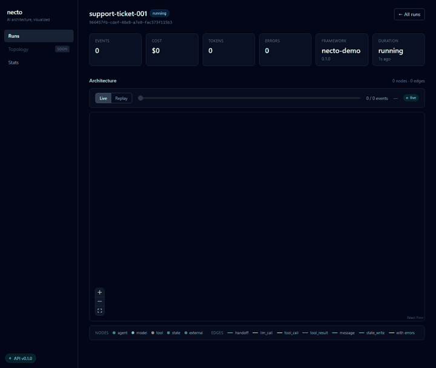
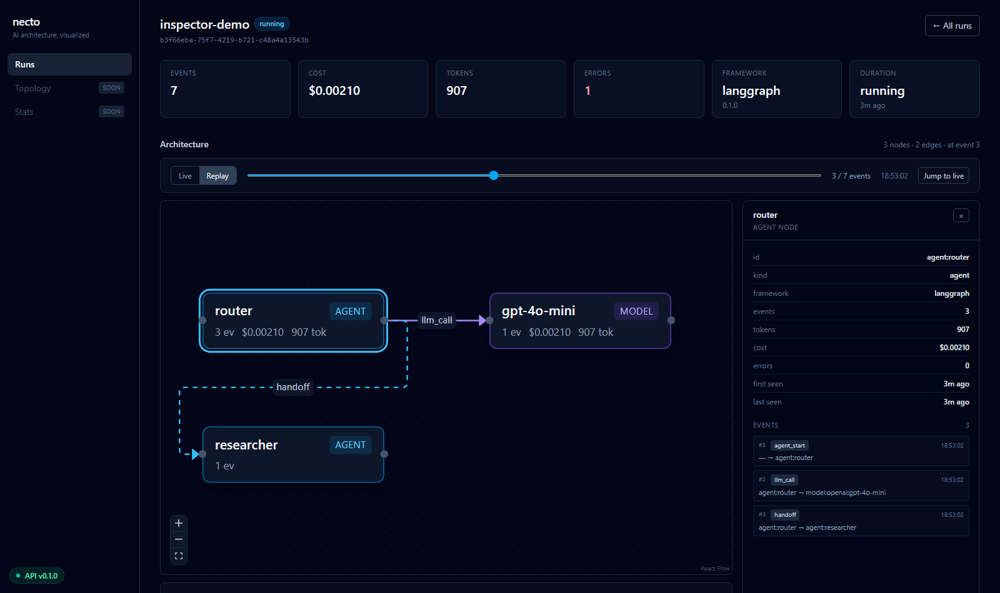
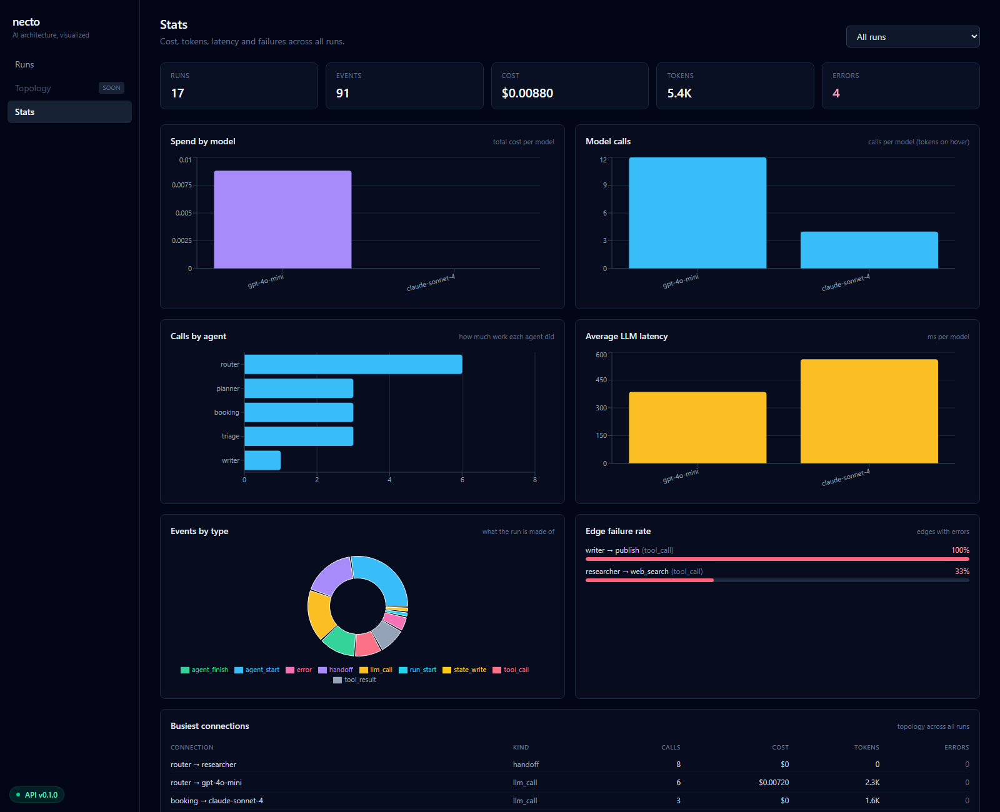
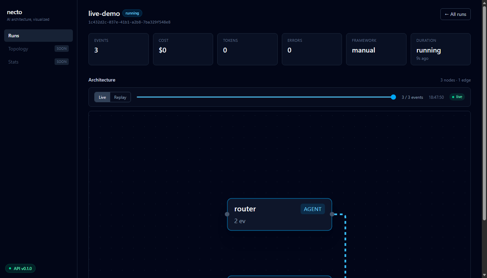
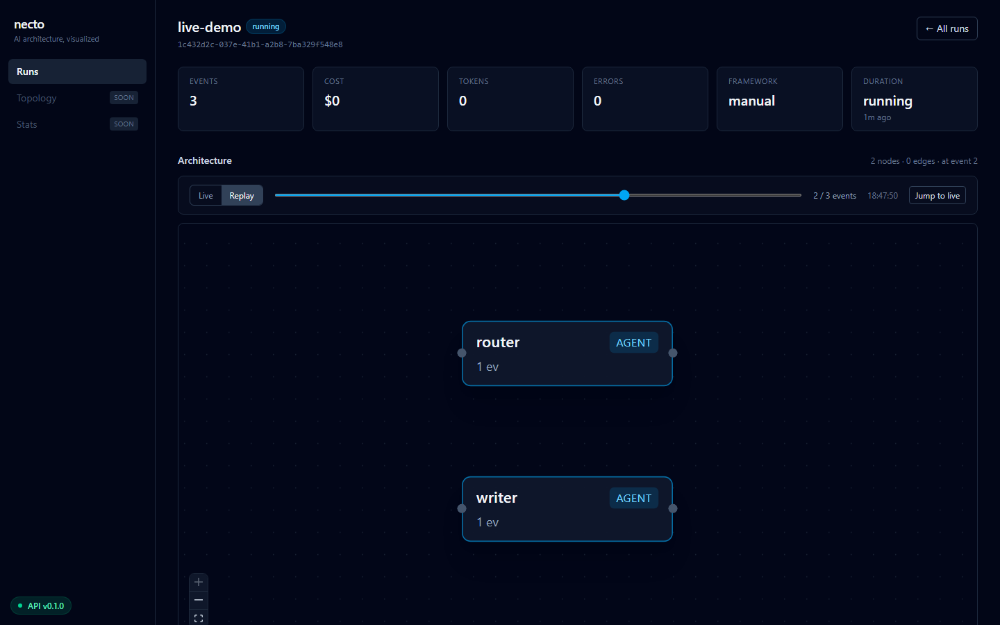
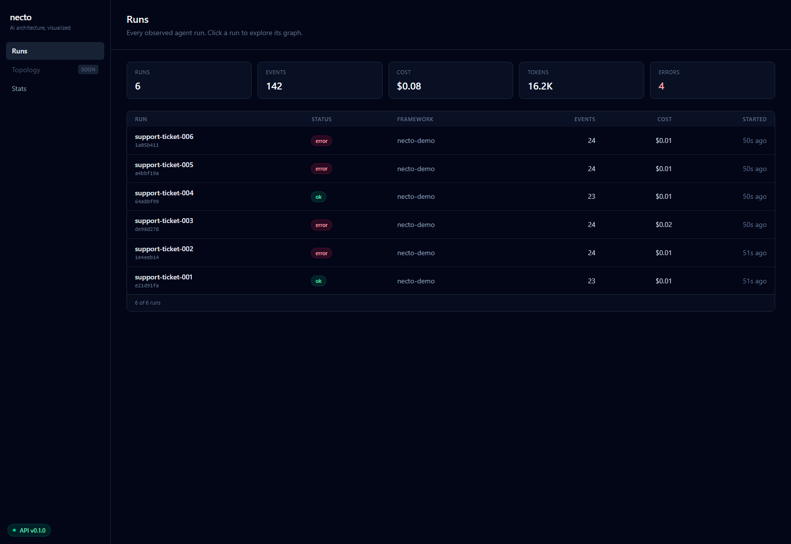
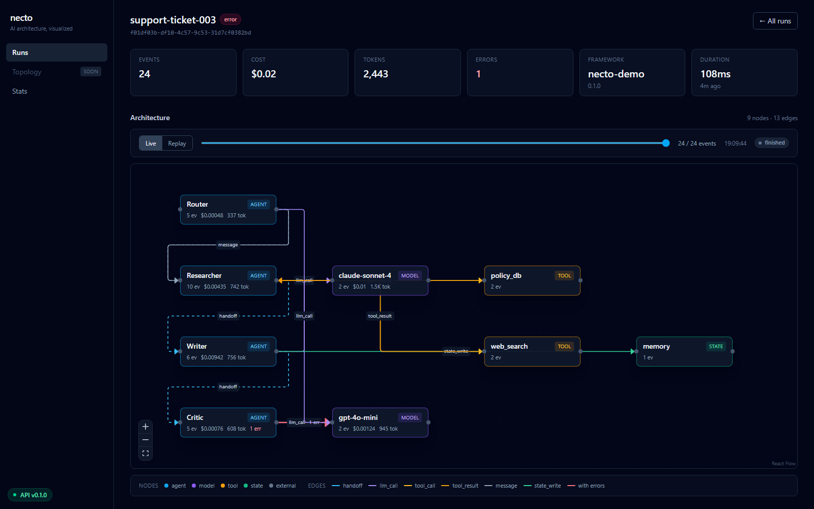

# necto

> *necto* — Latin: "I bind, I connect, I join."

**necto draws a map of your AI system.** Point it at an app built from multiple agents, models and
tools, and it renders the whole thing as one interactive network graph — so you can see how your AI
actually works, instead of piecing it together from logs.




---

## The goal

> **Make it easy for developers to map out their AI architecture — so the problems and workflows
> inside it become something you can *see*, not something you have to guess.**

Multi-agent systems *are* graphs: one agent hands work to another, calls a model, uses a tool, passes
the result back. But we build and debug them like lists — reading logs line by line, holding the
wiring in our heads.

necto gives that graph a face: agents, models and tools as nodes; calls, tool uses and **handoffs**
as edges. Click any connection and see what travelled over it.

## Why not just use a trace viewer?

Trace tools answer *"what happened in this request?"*. necto answers a different question:
*"how is my system wired, and where does it break?"*

| | Trace list (LangSmith, Langfuse, …) | necto |
|---|---|---|
| Primary view | chronological spans | **the topology of your system** |
| Handoffs | just another span | **first-class, highlighted edges** |
| Across runs | filters and diffs | **one aggregate map of everything** |
| Cost / latency | per call | **per agent and per model, on the graph** |
| Data model | vendor-specific | open event schema; any framework |
| Hosting | paid tiers for teams | MIT, runs entirely on your machine |

They are complementary: keep your tracer for deep per-request debugging, and use necto to understand
the system. necto is early — the tracer ecosystem is far more mature.

## What it looks like

Clicking a node or edge opens an **inspector** with its metrics and the exact events behind it,
including raw payloads:



A **stats dashboard** covers spend, calls, latency and failures per model and per agent, plus
per-edge error rates:



The runs list supports **search, framework filtering, sorting and pagination**; clicking a node dims
everything not directly connected to it, and hovering an edge shows its metrics.

A live run **builds the graph as it happens**, and the **replay scrubber** rebuilds it at any point:




## Quickstart

### One command

```bash
docker compose up -d --build
```

Open **<http://localhost:8000>** — the API, the built UI and a seeded database come up together.
Set `NECTO_SEED: "0"` in `docker-compose.yml` for a clean instance instead of demo data.

### Local development

Requirements: Docker, Python 3.12+, Node 20+.

```bash
docker compose up -d db

# API
cd server
uv sync
uv run alembic upgrade head
NECTO_SEED=1 uv run uvicorn necto_server.main:app --reload

# UI (new terminal)
cd web
pnpm install
pnpm dev
``` 

Open **<http://localhost:5173>** — with `NECTO_SEED=1` the empty database is filled with six
realistic demo runs on first boot, so there is something to explore immediately.



## Try the demo

Generate a fresh multi-agent run at any time — router → researcher → writer → critic, including a
**silent handoff failure** (the router drops the order id; nobody notices until the critic rejects
the draft):

```bash
python scripts/demo.py                    # 3 runs, uses the repo SDK
python scripts/demo.py --delay 0.4        # slow it down and watch the graph build live
python scripts/demo.py --clean            # no failures
``` 



## Python SDK

Three lines to instrument a LangGraph app:

```python
from necto_sdk import Necto
from necto_sdk.adapters.langgraph import NectoCallbackHandler

handler = NectoCallbackHandler(Necto(endpoint="http://127.0.0.1:8000", framework="langgraph"))
graph.invoke(inputs, config={"callbacks": [handler]})
```

| Adapter | Attach with |
|---|---|
| LangGraph / LangChain | `NectoCallbackHandler(necto)` in `config={"callbacks": [...]}` |
| OpenAI Agents SDK | `instrument(necto)` from `necto_sdk.adapters.openai_agents` |
| OpenTelemetry | `instrument(necto)` from `necto_sdk.adapters.otel` |
| Anything else | plain tracer: `run.agent_start()` / `handoff()` / `llm_call()` / `tool_call()` |

Want to define **your own agents, models, tools and handoffs** instead of using a framework? See
[Bring your own agents and models](docs/BRING-YOUR-OWN.md) — a JSON-configured pipeline runner that
makes real OpenAI / Anthropic calls (with a dry-run mode that needs no keys).

The SDK has **zero runtime dependencies**, buffers events and flushes them in the background, and
**never raises into your app** — if the server is down, events are dropped and logged.

Configure it once from the environment with `Necto.from_env()` — it reads `NECTO_ENDPOINT`,
`NECTO_API_KEY`, `NECTO_FRAMEWORK` and `NECTO_ENABLED` (`0` disables shipping entirely):

```python
from necto_sdk import Necto

necto = Necto.from_env()
```

Robustness details: a `429` is retried **honouring `Retry-After`** (other 4xx are not retried),
buffered events are flushed at interpreter exit even if you forget `close()`, and `close()` is
safe to call twice.

```bash
pip install -e sdk/
``` 

## How it works

text
SDK or HTTP  ──▶  event log (schema v1)  ──▶  graph projection  ──▶  API  ──▶  graph UI
 

Events are the source of truth; **the graph is computed, never stored**. That is what makes replay,
diffing and the aggregate topology cheap. Read [docs/ARCHITECTURE.md](docs/ARCHITECTURE.md) and the
normative [docs/SCHEMA.md](docs/SCHEMA.md).

## Status

| Piece | State |
|---|---|
| Backend — ingestion, graph, query, live WebSocket | ✅ done · **84 tests** |
| Python SDK — tracer + LangGraph / OpenAI Agents / OpenTelemetry | ✅ done · **64 tests** (incl. a real LangGraph run) |
| Web UI — runs, graph, live, replay, inspector, stats | ✅ done · **31 tests** (vitest) |
| Self-host via `docker compose` | ✅ verified (PostgreSQL 16 in Docker) |
| CI, PyPI release, GitHub release | ⬜ Phase 5 |

necto is **pre-release**: usable, tested and documented, but not yet published to PyPI and without a
CI pipeline. The roadmap lives in [PLAN.md](PLAN.md); current status and audit history in
[docs/HANDOFF.md](docs/HANDOFF.md).

## Docs

- [SPEC.md](SPEC.md) — vision and positioning
- [PLAN.md](PLAN.md) — the build plan
- [docs/ARCHITECTURE.md](docs/ARCHITECTURE.md) — system design
- [docs/SCHEMA.md](docs/SCHEMA.md) — event schema v1 (the contract)
- [docs/DEVELOPMENT.md](docs/DEVELOPMENT.md) — environment setup, troubleshooting
- [docs/HANDOFF.md](docs/HANDOFF.md) — status, audits, roadmap
- [examples/](examples/README.md) — runnable examples, including real LangGraph / OpenAI Agents apps

## Development

### Server

```bash
cd server
uv sync
uv run alembic upgrade head
uv run uvicorn necto_server.main:app --reload     # http://127.0.0.1:8000/docs
``` 

### Web UI

```bash
cd web
pnpm install
pnpm dev            # http://localhost:5173  (proxies /v1 + WebSocket to :8000)
``` 

### One command

```bash
./scripts/dev.ps1                 # database + migrations + API + UI (Ctrl+C stops the servers)
./scripts/dev.ps1 -CheckOnly      # validate prerequisites and print the plan
./scripts/dev.ps1 -ApiPort 8001   # if 8000 is taken
```

Reset the database (schema stays): `cd server && uv run python ../scripts/reset.py --yes`
(add `--seed 6` to refill demo data).

### Tests

```bash
cd server && uv run pytest -q          # 84 server tests
cd ../sdk && uv run pytest -q          # 64 SDK tests (uv manages the SDK venv)
cd ../web && pnpm test                 # 31 frontend tests (vitest)

# lint (repo-wide, from server/)
cd ../server && uv run ruff check .. && uv run ruff format --check ..
``` 

### Regenerate the demo GIF

```bash
python scripts/demo_gif.py               # Edge + Pillow, no Playwright/ffmpeg
``` 

### Backfill agent/model registries

```bash
cd server
uv run python scripts/backfill_registries.py
``` 

## API (v1)

### Ingestion

| Method | Path | Purpose |
|---|---|---|
| `POST` | `/v1/runs` | Create a run |
| `POST` | `/v1/runs/{id}/events` | Append a batch of events (server assigns `seq`) |
| `POST` | `/v1/runs/{id}/finish` | Mark a run finished |

### Graph

| Method | Path | Purpose |
|---|---|---|
| `GET` | `/v1/runs/{id}/graph` | Per-run network: nodes + edges |
| `GET` | `/v1/topology` | Aggregate network across all runs |

### Query

| Method | Path | Purpose |
|---|---|---|
| `GET` | `/v1/runs` | List runs (`?status=`, `?q=`, `?framework=`, `?sort=recent\|oldest\|cost\|events\|name`, `limit`, `offset`) |
| `GET` | `/v1/runs/{id}` | Run detail |
| `GET` | `/v1/runs/{id}/events` | Page through events (`?after_seq=`, `limit`) |
| `GET` | `/v1/stats` | Cost / tokens / latency rollups (`?run_id=`) |
| `GET` | `/v1/agents` | Agent registry |
| `GET` | `/v1/models` | Model registry |
| `GET` | `/v1/frameworks` | Distinct frameworks seen on runs |

### Live

| Protocol | Path | Purpose |
|---|---|---|
| `WS` | `/v1/live/runs/{id}` | Stream new events and run-finished notices |

### Authentication

Off by default. Set `NECTO_API_KEY` to require an `X-API-Key` header on every `/v1`
endpoint, including the WebSocket. `GET /`, `/healthz` and `/docs` stay public.

### Pagination

`GET /v1/runs` returns an `X-Total-Count` header with the unpaginated total.

## License

MIT — see [LICENSE](LICENSE).